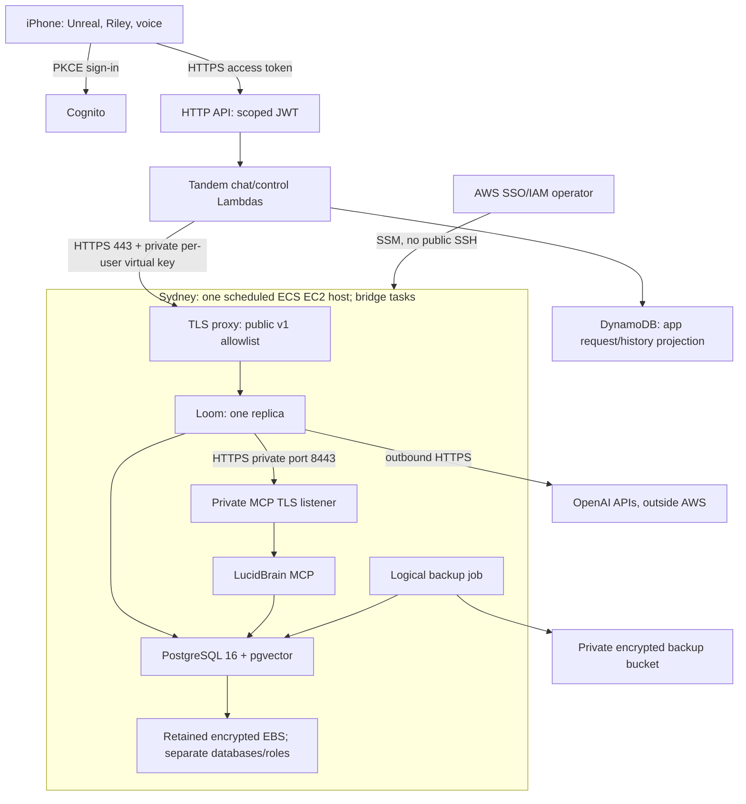

# Tandem on AWS: pilot decision and release contract

Design for [Loom #47](https://github.com/FieldstateNZ/loom/issues/47), dated **27 October 2026**, Sydney (`ap-southeast-2`), USD. **Proposed for review; no resources provisioned, no new spend, no production migration or model call.** Read the [compatibility matrix](compatibility.md), [owned backlog](backlog.md) and [validation plan](validation.md) with this decision.

## Decision

Use **Amazon ECS**, starting with a **scheduled single-EC2 development pilot**, then move to private Fargate application services and managed PostgreSQL when availability and budget justify it. Keep the existing Tandem Cognito → HTTP API → Lambda → DynamoDB entry point. OpenAI remains the intended inference provider; AWS hosting does not select Bedrock.

The budget exception is deliberate: issue #47 asked for an ECS/Fargate-versus-EKS recommendation, but Brett subsequently said even USD 10–30/month before AI is expensive for a few testers. An always-on Fargate/RDS environment does not meet that intent. ECS on EC2 reuses the ECS deployment model without a Kubernetes control plane, NAT gateway, load balancer or managed database in the first development tier. This is a testing tier on the route to the full application, not a substitute for an always-available daily assistant.

| Configuration | Estimated monthly infrastructure | Meaning |
| --- | ---: | --- |
| Recommended development pilot: 4 GB `t4g.medium`, **40 total running hours** | **USD 9.65** | Host stopped outside agreed test windows; persistent data, DNS and IPv4 retained |
| Same pilot running 730 hours | **USD 38.91** | Still one host/AZ and self-managed PostgreSQL; no HA claim |
| Managed private-network reference | **USD 257.77** | Fargate, Multi-AZ RDS, two ALBs, two NAT gateways; future reference, not approved sizing or spend |

Figures are calculated by [cost-model.py](cost-model.py) from [public AWS rate snapshots](pricing-inputs.json), including SKU/effective date. [Full line items](cost-estimate.json) distinguish published rates from planning allowances. Reproduce with `python3 docs/aws/cost-model.py --check`. No free credits, reservations, Savings Plans or AI charges are assumed. Taxes, domain registration, character production/distribution and operating time are excluded. Extra usage, storage, telemetry and transfer remain variable. Suggested pilot review envelope: **USD 12/month before AI**, including about USD 2.35 headroom; it is a recommendation, not an approved budget or a billing cap.

Stopping compute does **not** remove EBS, snapshots, retained IPv4 or DNS charges. One retained IPv4 alone is USD 3.65 for a 730-hour month. The pilot assumes 24 GB gp3 (8 root + 16 data), 2 GB retained images, 2 GB logical backups, 2 GB snapshot data, 0.1 GB logs, three alarms, one custom metric, 100 logical chat turns and at most 5,000 total HTTP requests/month. The latter serverless/control/transfer amounts are explicit allowances, not per-service price quotes. Maintenance, startup and backup running time must fit the 40-hour total.

[EKS](https://aws.amazon.com/eks/pricing/) adds USD 73/month for a standard-support cluster before nodes. [Lightsail](https://docs.aws.amazon.com/lightsail/latest/userguide/amazon-lightsail-bundles.html) is simpler for a fixed-price VM, but its 4 GB IPv4 plan is USD 24/month before backup/operations and does not provide this ECS delivery path. A 2 GB VM is not selected: the combined production images and memory envelope have not been qualified there. Do not introduce Spot for the only PostgreSQL host.

## Evidence and shared-platform boundary

The pinned [source inventory](source-evidence.json) records the inspected repositories and exact paths. Loom application changes are tested at `37f4e4f…`; LucidBrain identity/task changes at `896e52b5…`. These remain draft PRs, not the code currently deployed to AWS. This documentation branch is based on Loom main `58c6ab6e…` and describes the proposed release set explicitly.

- `infrastructure@b753b5fe…` describes Lucentroot k3s/Argo CD/Tailscale/OpenBao, not a verified AWS runtime.
- `saas-fabric-platform@66b5c369…` production manifests target AKS and `managed-csi`; they cannot be applied unchanged to AWS.
- `saas-fabric@380b6e42…` supplies control/runtime-plane patterns, Keycloak reconciliation and Kubernetes observation. Its FGA adapter exists but is not wired into `fabric-api`. It does not replace Loom execution storage or LucidBrain memory/tasks.
- `saas-fabric-clients@b26f5985…` is client desired-state data, not hosting infrastructure. No client files should be changed by this work.
- The referenced `saas-fabric-hosting` repository was inaccessible through Git and the connected repository API. This is an access observation, not proof that no AWS deployment exists. Reconcile hosting ownership before implementing a new foundation.
- Reuse environment isolation, immutable images, secret references, deployment approvals and telemetry boundaries. Do not install a second Argo CD, Keycloak, OpenBao, Kubernetes cluster or SaaS control plane merely to run Tandem. ECS is an explicit application-hosting exception; shared-platform owners must be able to consume its deployment/health outputs. No fabricated Fabric registration adapter is claimed.

[Actual Tandem API evidence](tandem-api-evidence.json): 19 combined service checks, three synthetic tasks, only model Responses simulated. Tandem also passes 48 backend/infrastructure tests and 14 private-memory checks. Those tests use real services/databases, but **LucidBrain uses its hand-built test schema, not its complete production migration chain or pgvector**. Full image startup/migrations are therefore an independent deployment gate.

## Pilot topology and network

Use a dedicated VPC/subnet/SG and a pinned ECS-optimized AL2023 ARM64 AMI. One standalone, tagged EC2 instance is stopped/started; no ASG replaces or terminates it during scheduled stops. EBS and the Elastic IP are retained independently. Host replacement is an explicit same-AZ restore operation, not an automatic scale-out promise. All workloads are trusted application images for one pilot environment; no model-supplied code or arbitrary execution container is permitted.

Use ECS **bridge** networking with fixed, non-overlapping host ports. Docker outbound traffic uses the host public address, avoiding a NAT gateway. ECS EC2 `awsvpc` tasks do not inherit that public egress path; switching networking modes silently would invalidate this cost/design. See [AWS outbound networking](https://docs.aws.amazon.com/AmazonECS/latest/developerguide/networking-outbound.html) and [bridge mappings](https://docs.aws.amazon.com/AmazonECS/latest/developerguide/networking-networkmode-bridge.html).

Only 443 and ACME challenge traffic on 80 are public. The TLS proxy is a pinned, maintained image (Caddy is the proposed implementation); port 80 serves certificate challenges/redirects only. Public 443 additionally reserves the authenticated `/tandem/` prefix for the planned SSE relay. It otherwise permits the specific owned `/v1/whoami`, `/v1/mcp-servers` and conversation/action paths used by Tandem. Deny `/admin`, `/mcp`, `/internal`, batch and unneeded endpoints. Exact-path/method allowlist tests must accompany the proxy configuration. A missing/private credential is still rejected by Loom. Do not log Authorization, request bodies or sensitive query strings.

Private host ports 8080 (Loom), 8081 (LucidBrain), 8082 (Tandem relay), 8443 (MCP TLS), and 5432 (PostgreSQL) must be unreachable from the internet and unrelated SGs, including IPv6 paths. The public-subnet host is **not** described as a private-subnet deployment. Private service access is bounded by the host/bridge and SG/firewall, with TLS for MCP and database clients. SSM access is operator-only with CloudTrail/session auditing; no public SSH or admin listener.

Require an owned `runtime.dev.<approved-domain>` before provisioning TLS. Public DNS points at the retained EIP. The private MCP URL keeps the same hostname on port 8443; ECS `extraHosts` resolves that hostname to the host private address for Loom. This uses a valid public certificate without publishing the private listener. The proxy terminates TLS and forwards locally to LucidBrain, preserving Authorization and all four expected-identity headers. Certificates renew during test windows; startup checks expiry. No private CA is needed for MCP, and no insecure HTTP exception or provider reachability assumption is introduced. Local proxy-to-process HTTP stays on the one trusted host. Test routing, SNI, trust and denies; this configuration is proposed, not already verified.

Separate ECS services/tasks for PostgreSQL, the proxy, Loom, LucidBrain and the planned Tandem stream relay may use fixed host ports and explicit placement on the dedicated instance. Deployment orchestration starts DB, runs one migrator per database, then applications/proxy. Fixed ports and retained local data require **stop-before-start** (`minimumHealthyPercent: 0`, `maximumPercent: 100`, desired count 1). This deliberately causes a development outage. No blue/green database copies may share the data directory. Register the actual private IP in task configuration and regenerate it during a host replacement; do not hardcode it in source.

## Persistence, migration and restore

Select PostgreSQL **16 with pgvector**, at pinned minor/image digests after qualification, to match the actual-service baseline. Loom's separate PG18 CI is useful compatibility evidence; it does not qualify LucidBrain's full migrations on PG18 or establish RDS region/extension availability. Before any managed release, query the actual account/region engine and extension versions. Do not infer availability from a price-list SKU.

One physical pilot cluster contains separate `loom_dev` and `lucidbrain_dev` databases. Each has distinct runtime and migration roles; revoke broad PUBLIC connect/create permissions. Bootstrap pgvector in the LucidBrain database with the administrative role, then use the schema-owning migrator. Runtime roles get only required connect/usage/DML/sequence privileges and future default grants, not superuser or DDL. Do not share Loom's credentials with LucidBrain or run both schemas in `public` in the same database.

Database clients require `sslmode=verify-full`, a pinned CA and a hostname matching the server certificate. The managed tier must follow [RDS PostgreSQL SSL guidance](https://docs.aws.amazon.com/AmazonRDS/latest/UserGuide/PostgreSQL.Concepts.General.SSL.html). Include Node/SQLx trust tests; the pilot PostgreSQL TLS key is a separate secret from application encryption. Mount certificate/key material at restrictive permissions. Map certificates/hostnames via configuration; never switch to `rejectUnauthorized:false` or `sslmode=disable` to get a green smoke test.

Pilot budget: PostgreSQL `max_connections=80`; one Loom pool budget 10, one LucidBrain pool 10, migration/backup/operator/readiness allowance 10, leaving at least 50 reserved/headroom. The current code uses SQLx and node-postgres default pools; it does **not** read a proposed `LOOM_DB_MAX_CONNECTIONS` or `PG_POOL_MAX` setting. Qualify pinned defaults or add explicit bounded configuration before relying on those names. Conversation advisory locks hold a connection for the full model/tool loop and may need other connections for work; test two concurrent users plus action checks and readiness without pool starvation. Keep transaction idle timeouts above the bounded run/drain window; timeouts must leave uncertain writes recoverable.

Run migrations once per release before application traffic. Loom currently runs embedded SQLx migrations at startup and has no migration-only command; add a bounded `--migrate`/equivalent entry point, then set `LOOM_RUN_MIGRATIONS=false` on runtime tasks. LucidBrain's Docker entrypoint runs its migration program on every boot, so the runtime must use an explicit server-only entrypoint and a separate migration task. Its runner tracks filenames and transactions but has no cluster-wide migration lock; serialize it in deployment and add/test an advisory lock before concurrent releases. Both migrators use dedicated credentials. A failed migration stops release, leaves the prior image/DB evidence intact and is never “fixed” by deleting a database.

Retain encrypted EBS data on task/host/stack deletion. Root is rebuildable; PostgreSQL data is not stored in ephemeral container layers. A backup task uses TLS to dump both databases to private S3 with checksums, one shared backup-set ID, versioned manifests and bounded retention. Before a coordinated logical backup, block new mutating traffic, pause provisioning/ticks, drain and stop both application writers while PostgreSQL stays running, then dump both databases. Two independent live logical dumps do not provide a consistent cross-database cutoff. Hourly development backup therefore includes a brief planned outage; a later physical/WAL backup strategy must prove a consistent cutoff before replacing it. Take logical backups before migration/shutdown and during each test window; the scheduler must wait for successful backup/drain before a normal stop. Also test an ungraceful stop. EBS snapshots complement logical backups; a live-volume snapshot alone is not proof of a consistent application restore.

Proposed development recovery targets: RPO no worse than the last successful hourly/window-close backup; RTO within one hour while an operator is available. They are targets until demonstrated, not an SLA. Restore into an isolated replacement cluster, verify migrations, identities, histories, usage and action receipts, and compare task/item IDs before promotion. Store key/pepper versions with the backup manifest, without putting secret values in it. Preserve receipts and unknown operations during restore; never create fresh operation IDs to hide uncertainty.

## Secrets, IAM and identity

| Value / access | Source and lifecycle |
| --- | --- |
| `DATABASE_URL` | Separate runtime/migration SecureStrings per service/environment; rotate role passwords using overlap/restart, not a shared administrator DSN |
| `LOOM_ROOT_ADMIN_TOKEN` | Operator bootstrap/admin only; injected into Loom, public proxy denies admin; rotate by task replacement |
| `LOOM_ENCRYPTION_KEY` | Durable 32-byte application key, not regenerated on restart; current ciphertext has no transparent key-ring rotation. Rotation needs tested decrypt/re-encrypt migration, backup and rollback |
| `LOOM_KEY_PEPPER` | Explicit independent stable value; don't rely on derivation from encryption key. Changing it changes virtual-key lookup hashes; retain/replace all virtual keys and Tandem bindings in a coordinated cutover |
| OpenAI provider key | Private encrypted Loom credential store after explicit live-test authorisation. Not in iOS, Git, IaC plaintext or LucidBrain unless embeddings are separately authorised |
| LucidBrain OAuth/MCP credential | Encrypted in Loom, scoped to stable principal/workspace/assistant/credential. Refresh and replacement must preserve or deliberately fence logical identity |
| LucidBrain `SESSION_SECRET`, `MCP_SECRET_KEY` | Independent SecureStrings; production boot rejects weak session secrets. MCP-secret rotation requires its own encrypted-data plan |
| `INTERNAL_TICK_TOKEN` | Leave absent and internal scheduled actions disabled for the task-inbox pilot; not a substitute for future scheduled-worker ownership |
| Tandem `/tandem/dev/loom/bindings` | Existing encrypted per-Cognito-sub manifest. Only chat/control Lambda roles read it. Revoke/supersede secrets deliberately; cached reads have bounded refresh |
| PostgreSQL TLS key / CA | Private key scoped to DB task; CA-only trust mount for clients. Separate from backups' public metadata |

Use Standard SecureString with AWS-managed encryption initially; do not add multiple paid custom KMS keys accidentally. Scope execution roles to exact parameter ARNs and required KMS decrypt context. ECS execution role handles image pull, secret injection and logs; application task roles do not gain parameter-list/read access. Backup role can upload only its environment prefix; restore reads require a separate operator role. Host role runs ECS/SSM and cannot list application secrets. Block application access to EC2 instance metadata; task credentials must not fall back to host credentials. Bridge-task/host compromise remains a pilot trust boundary, not strong isolation between mutually untrusted tenants. Non-root LucidBrain, restricted capabilities, read-only runtime filesystems where supported, IMDSv2 and pinned images are deployment gates.

The phone authenticates via Cognito authorization-code/PKCE; HTTP API validates issuer/audience and `tandem/access`, and Lambda verifies access-token claims. The verified subject selects a distinct Loom tenant/virtual key, with LucidBrain principal/workspace/assistant mapping provisioned server-side. Current identity endpoints verify a mapping; they do **not** create or prove the human's entitlement automatically. Production provisioning, refresh/revocation, account switching and erasure are owned backlog items.

Canonical state: Cognito owns human login; Tandem owns persona revisions, app session IDs, request fences and visible transcript projection; Loom owns provider history, execution/tool/action state and metering; LucidBrain owns memories, task rows and capture receipts. `action.id` is the immutable `capture_item.operationId`. Neither model text nor an HTTP 200 authorises or proves a task write. No duplicated canonical task/memory store is introduced in Tandem, Fabric or DynamoDB.

## Streaming, cancellation and worker ownership

Loom gateway memory sends five-second keepalives and safe activity, but buffers final text until validated and stored. **The current Tandem API returns final JSON; the phone does not yet show a streamed task/result.** Keep the current 22-second gateway deadline, 26-second Lambda handler deadline, 28-second Lambda timeout and 29-second API integration limit. The selected first client-streaming path is a separate Tandem SSE relay container behind the existing TLS proxy; the Lambda final-JSON path stays available. It is work to implement, not an existing capability. Natural Realtime voice remains a later media/session integration.

The relay will accept Cognito access tokens on a distinct `/tandem/` public prefix and verify signature, issuer, app-client identity, expiry, token-use and `tandem/access` against the configured pool/JWKS. It selects the private subject binding exactly as Lambda does. The existing single-token development `backend/server.mjs` must **not** be exposed as that relay. Use the same DynamoDB request admission/fence/projection logic and the same 22-second turn budget initially; do not bypass ownership or enlarge the lease by putting HTTP in a container.

`POST /tandem/v1/chat/stream` carries the existing session/request UUIDs and text. The relay emits versioned app presentation events for safe activity, a persisted final reply and validated action snapshots; no raw provider reasoning or credentials. Gateway memory currently buffers final text, so the first stream carries activity plus final content, not an invented token-by-token guarantee. Confirm/reject/cancel remain the authenticated action API; the card/result updates from that API's verified receipt. `GET /tandem/v1/sessions/{id}/requests/{requestId}/events` is read-only recovery: derive terminal reply/request status and the latest retained action snapshots, without starting inference or re-dispatching. Transient activity is explicitly lossy; no full historical event replay is claimed. Use session/request/action IDs to deduplicate snapshots. Later normative OASP events should reuse the existing session-event work rather than treating this UI projection as a second canonical event store.

A reconnect checks status read-only first; it cannot automatically repeat an unknown paid turn. The phone refreshes its token and reconnects using the original IDs, validates the exact request/action scope and preserves unresolved actions when changing conversation/account. The relay needs the exact SSM binding reference and DynamoDB permissions, not a Loom admin token. Treat it as the Tandem experience boundary in **Tandem → Loom → LucidBrain**, never as a new agent/memory owner. Include a proposed 256 MiB relay reservation/512 MiB ceiling in the 4 GB pilot qualification. The managed reference includes a .25-vCPU/.5-GB relay task; the prototype is not declared complete merely by bringing up the cheaper non-streaming endpoints.

Disable proxy buffering and set an idle timeout above the heartbeat interval (proposed 75 seconds) with a whole-run limit. No retry middleware may repeat an uncertain turn or write. A lost response uses request/action IDs and read-only status/reconciliation. Generation guards prevent late output after cancellation; a fenced chat can still reconcile its tasks. Before dispatch, cancellation prevents the write. After dispatch it records intent and may still recover a completed receipt. A canceled unconfirmed operation with no visible receipt lacks an authoritative no-effect tombstone today; keep it unresolved and retain access to its ledger.

Loom catches SIGTERM and drains HTTP requests; set a tested stop timeout up to 120 seconds and prevent new traffic first. LucidBrain's current `index.ts` lacks explicit HTTP/DB graceful shutdown; add and test it rather than claiming the Docker entrypoint's `exec` is enough. If killed, recover from durable request/action fences and receipts. Proxy, task and DB restart tests must include a capture that commits before its response is lost.

Run **one Loom replica**, no overlapping rollouts. [Issue #10](https://github.com/FieldstateNZ/loom/issues/10) is closed for the single-instance limiter, with distributed enforcement explicitly deferred. Rate buckets and budget caches remain process-local; PostgreSQL conversation/action locks do not make them global spend limits. Set `LOOM_BATCH_POLL_INTERVAL_SECS=0` to disable the worker for this interactive pilot and deny batch routes at ingress. The batch code has an atomic submission claim, but a crash can strand `submitting`; provider submission/result reconciliation is separate work. Do not enable duplicate pollers, scheduled-message tick or LucidBrain startup deployment reconciliation as an assumed safe multi-replica worker. Gate/disable unused managed-agent redeployment in the pilot configuration before startup; the current unconditional startup reconciler is a concrete compatibility gap.

## Delivery, operations and managed path

- Owners: Tandem repository owns mobile/API/DynamoDB/CDK entry stack; Loom owns runtime/image/contracts; LucidBrain owns MCP, schema and service image. A bounded AWS runtime module must have one agreed hosting owner, preferably `saas-fabric-hosting` once accessible; until resolved, prepare an isolated Tandem runtime stack without mutating shared platform/client state. Outputs expose environment, image digest, endpoint and health, not secrets.
- GitHub deployment jobs use OIDC and environment-restricted roles (`aud=sts.amazonaws.com`, exact repository/environment `sub`), no permanent AWS key. Separate image publish, infrastructure change and migration roles. Runtime rollout does not get arbitrary IAM/PassRole/stack-delete permissions.
- Build in CI from committed source; scan and publish immutable Linux ARM64 images to private ECR. Current Loom Linux CI is not ARM proof. Pin LucidBrain/base/pgvector/proxy images and verify its production bundle, non-root startup and migrations. Build helpers must never send `.env`, test credentials or File Provider artefacts in a Docker context.
- A release manifest pins source/image/architecture, infrastructure revision, migrations, secret version references, database/TLS requirements and evidence. Dry-run plans and change review precede provision. This document creates no deploy role, image registry or resource.
- Readiness: Loom `/readyz` checks PostgreSQL; `/healthz` is process liveness. LucidBrain `/api/v1/healthz` checks DB, so add a separate process liveness probe if needed. Bound startup budgets for migrations, and keep traffic off until TLS, DB and schema checks pass.
- Log request IDs, status, duration, migration/image IDs and aggregate usage. Keep content capture off (`LOOM_TELEMETRY_CAPTURE_CONTENT=0`); audit existing LucidBrain error paths before live keys because some log upstream error bodies. No private prompts, tool results, headers or credentials in routine logs/traces. Disable optional Sentry/OTLP unless an approved private destination and redaction policy exist.
- Alert on API errors, readiness failures, backup age, storage, CPU credits and cost. Three priced alarms/one metric are a pilot allowance, not unlimited dimensions. AWS Budgets warns; it is not a hard synchronous cap. Planned runtime windows, daily request admission, gateway key budgets and offline-by-default scheduling bound exposure. Do not auto-start new paid capacity from a phone prompt.
- Rollback restores previous immutable images only for compatible schema. Destructive migrations need expand/contract or a verified isolated restore with corresponding key versions; do not roll application code back against an incompatible database or promote a stale backup over committed tasks.

For the managed path, preserve the same application contracts and move to separate Fargate `awsvpc` services, RDS PostgreSQL Multi-AZ, private tasks, per-AZ NAT, public ALB only for the allowlisted Loom API and a **private** TLS ALB for MCP. ACM public-domain DNS validation can provide a trusted certificate on the private listener; private DNS resolves it only inside the VPC. Preserve the canonical MCP hostname/port where possible so an infrastructure move does not silently change an action's endpoint identity. RDS CA trust, extension permissions, restore and connection limits must be requalified. The USD 257.77 reference includes those fixed network/data services at small assumed sizes, but it does not prove HA: application replicas remain one until shared rate/budget state, worker coordination and concurrency tests pass. Horizontal/production scaling is a separate bounded milestone, not an ECS checkbox.

## Decisions that genuinely need Brett before activation

1. **Availability versus cost:** recommend the scheduled development tier within a proposed USD 12/month infrastructure envelope, with explicit off hours. If the pilot must answer any time, the same host estimate is USD 38.91; managed availability costs more. No amount or schedule is approved by this document.
2. **Owned hostname and hosting responsibility:** use a subdomain of an existing controlled Fieldstate domain; confirm DNS authority and the existing AWS hosting repository/account boundary before creating resources. Do not buy a domain or duplicate a platform to avoid this check.

These do not block API/UI work, local image/migration qualification, infrastructure synthesis or release-script preparation. Live AI testing remains explicitly deferred by the user; do not request or populate a key merely to finish the AWS design.

## Regional availability and sizing evidence limits

AWS public price catalogues retrieved on 27 October contain Sydney EC2, ECS/Fargate ARM, RDS PostgreSQL, EBS, ELB, S3, Lambda, DynamoDB, CloudWatch and ECR offerings; the rate snapshots retain publication dates. This establishes regional products/prices, not current account quotas, exact engine/extension support, ARM image compatibility or spare capacity. Those read-only checks remain mandatory with a fresh AWS session before activation. OpenAI model availability is a separate live-provider qualification.

The 4 GB host is a proposed resource budget, not a measured claim: budget approximately 1,280 MiB PostgreSQL, 640 MiB LucidBrain, 384 MiB Loom, 512 MiB relay, 96 MiB proxy and 192 MiB backup, with 768 MiB reserved for host/ECS. Their ceilings total 3,872 MiB, leaving 224 MiB; not all should peak together. Test startup, migrations and concurrent backup/load. If observed headroom is insufficient, reduce concurrency or re-cost larger compute before enabling it; do not silently use swap as proof of capacity. Build images in CI, bound local image/log retention and verify the 24 GB disk assumption.
