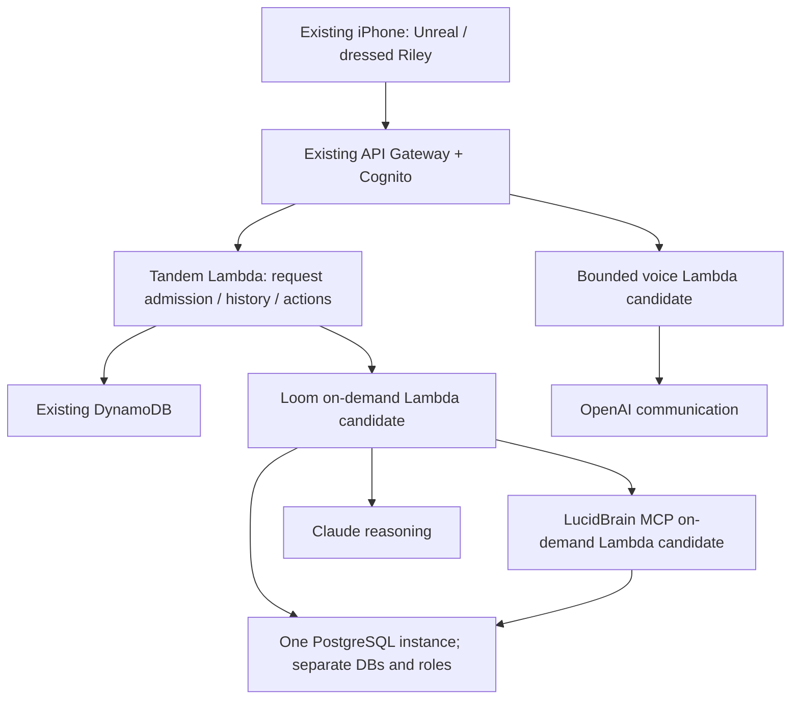

# Request-driven Tandem application services

Decision date: 28 October 2026. AWS region: Sydney. Currency: USD. This is a design/proof plan; nothing has been provisioned or reconfigured in AWS.

## Smallest useful topology

The application processes should be absent from the bill between requests, apart from retained images/data and small control allowances. Lambda duration still includes time awaiting model/tool replies. Count both Tandem and Loom when nested invocations wait for the same model response. The database is the only potentially continuous compute component.

## Database shortlist

| Candidate | Database-only base | Why consider it | What remains unproven |
| --- | ---: | --- | --- |
| Lightsail Linux IPv6-only, 512 MB / 20 GB | $4.30/month including 8 GiB attached disk + backups | Lowest fixed-price candidate found | Full 28-migration/pgvector and two-user memory/task flow within 512 MB including OS; networking and operations |
| Lightsail Linux IPv6-only, 1 GB / 40 GB | $5.80/month including 8 GiB attached disk + backups | Practical first database sizing candidate; bundled disk | Same runtime/backup checks and regional default-VPC peering |
| EC2 t4g.nano, 16 GiB total gp3 | $5.41/month + backups | Small VM in our own VPC | 512 MB host capacity, non-ECS 8 GiB AMI/root and private egress |
| EC2 t4g.micro, 16 GiB total gp3 | $9.27/month + backups | More memory and our own VPC | 1 GB host measurements, AMI sizing and private egress |
| Aurora PostgreSQL with zero-ACU auto-pause | $1.10/month at 10 GiB storage + $0.10 per awake hour at 0.5 ACU, plus I/O/backups | Managed database, cheap for long idle periods | Engine/extensions/roles/migrations, actual zero capacity and pool/wake behaviour; resume delay |

These are pre-tax list-price calculations, not new bills or hard caps. Lightsail is a self-managed VM here, not its managed-database product. The $3.50 option is a candidate to test, not an established capacity claim. The Lightsail VM plans themselves are $3.50/$5. The comparison adds an 8 GiB encrypted attached disk at $0.80/month for independently retained database data; the bundled disk is the OS volume. Do not assume bundled-root encryption or retention matches the existing encrypted data-volume contract. The EC2 16 GiB assumption is 8 GiB non-ECS root plus 8 GiB retained data; the old ECS AMI's 30 GiB root requirement does not apply automatically to a database-only host, but the selected new AMI must actually fit.

[Cost scenarios](serverless-cost-estimate.json) add application requests/duration and explicit small storage/log/backup allowances. All calculations exclude free trials, AWS credits and account-wide free allowances. The advertised t4g.small free trial is temporary/account-shared and must not be the steady-state business case.

**Provisional choice:** qualify a small database-only host alongside request-driven applications, starting with the 1 GB fixed-price option and measuring whether 512 MB is sufficient. Compare Aurora using measured awake hours and acceptable resume latency. At 40 awake hours the modelled Aurora and 1 GB Lightsail totals are within one dollar; at longer awake times the fixed-price host wins. At near-zero use, auto-paused Aurora has the lower compute floor. We have not selected the cheapest *qualified* option yet.

## Networking must not erase the savings

- Lightsail does not automatically provide the EC2 instance-role/SSM operator workflow. Use a reviewed manual bootstrap/maintenance path without long-lived AWS keys on the host; separately include any paid hybrid-management feature if chosen. A scheduled Lambda can own private-network database backups and its S3 IAM permissions. The base estimate assumes no paid hybrid management.
- Keep PostgreSQL off the public internet. Lambda connects through private IPv4 in the same VPC, or through Lightsail VPC peering. Lightsail peering is limited to the region's default VPC; inspect existing ownership before using it, and do not change unrelated routes or security groups. IPv6-only Lightsail instances still receive a private IPv4 address. Private peering/routing must be verified for the chosen plan.
- VPC-connected Lambdas use dual-stack subnets with outbound IPv6 enabled and an egress-only internet gateway. The gateway has no hourly fee. Public IPv6 exists only for outbound provider/service access; a database port must not be exposed over IPv6. Verify every required destination, including Claude/OpenAI, IAM-signed Lambda calls and parameter/secret access. DNS AAAA observations on this Mac are not an AWS network qualification.
- No NAT gateway or paid interface endpoint is assumed in the cheap totals. If an essential destination needs IPv4, use a separately costed outside-VPC provider/control invocation or revise the design explicitly. Do not silently add a NAT gateway.
- Preserve the existing public Cognito-authorised API. Internal Lambda HTTP/SSE is a candidate using IAM-authenticated function URLs and bounded route/signing adapters; preserve the application bearer and all four MCP identity headers separately from SigV4. Normal callers must not obtain admin/migration/operator routes. Operator functions have no public URL. These adapters and policies are not implemented yet.
- No public IPv4 or load balancer is needed merely to invoke Lambda. Keep Lambda provisioned concurrency, managed-instance capacity and periodic warmers out of the baseline. Treat actual response-stream limits as a transport contract, not a promise of an unlimited call.

## Source compatibility: changes actually needed

Inspected current Tandem `27ffc3d`, Loom `9c89574`, LucidBrain `bd3baa8`.

| Component | What can be reused | Required work |
| --- | --- | --- |
| Tandem | Node Lambda/DynamoDB handler and existing Cognito/API routes | Internal IAM transport, bounded cold/wake handling and cost measurement; retain identity/request/action fences |
| Loom | Rust HTTP server, PostgreSQL store, existing per-turn state and memory/task contracts | Lambda request lifecycle or AWS Web Adapter wrapper; disable batch poller/migrations, drain/cancel before freeze, cap/reconnect pools and qualify distributed admission/rate/budget behaviour |
| LucidBrain | Node HTTP/MCP server and stateless private workspace profile | Minimal Lambda entrypoint/wrapper; disable startup reconciliation, verify schema, cap/reconnect pools and preserve exact account attestation |
| Communication | Bounded transcribe/render worker and owned reply claims | Lambda-compatible invocation/audio limits and explicit interrupted-result handling; continuous Talk remains separate work |
| PostgreSQL | Existing logical schema/role/migration jobs | Same identities and master keys; small-host/engine compatibility, backups and recovery; no new memory store |

[AWS Web Adapter](https://github.com/aws/aws-lambda-web-adapter) supports HTTP frameworks and streaming in Lambda. That makes reuse plausible, not automatic. A container starting proves neither freeze/thaw correctness nor cancellation semantics. Preserve current source versions and existing tests; do not rerun paid model smoke just for a packaging experiment.

Source constraints: Loom's current PostgreSQL connect/acquire budget is 10 seconds, LucidBrain's connect timeout is four seconds, Tandem bounds inference around 22 seconds and its whole HTTP handler around 26 seconds. Aurora's typical resume is around 15 seconds and can exceed 30 seconds after long sleep. The current synchronous first-turn path cannot safely absorb that. An authenticated read-only warm/readiness request and visible pending state must precede paid inference, or select the small always-ready database. A wake retry must not repeat a model request, task or memory write.

Aurora does not auto-pause with open user connections; RDS Proxy prevents auto-pause. Frozen Lambda environments can retain sockets while their pool timers stop running. Explicit lifecycle/pool release and bounded server-side stale-session handling must be verified; do not claim scale-to-zero from a configuration flag. No RDS Proxy is included.

Multiple Lambda environments also mean multiple application replicas. Existing durable turn/admission/credential controls must be audited for this execution shape; local single-server success is insufficient. Use bounded database pools and account for the entire account's concurrency. The account previously could not reserve function concurrency below its required unreserved allowance; do not assume that a reserved-concurrency value can enforce one replica. Ordinary DynamoDB admission does not remove a need to qualify Loom's shared limits.

Data API would avoid VPC SQL connections, but Loom uses SQLx PostgreSQL and LucidBrain uses node-postgres/Drizzle, transactions and lock-sensitive identity/action operations. Data API is not a connection-string replacement. DynamoDB-only storage, Aurora DSQL or an external Postgres provider likewise require separate compatibility/ownership decisions; do not silently bypass Loom/LucidBrain or change providers.

## Next concrete proof

1. Package one actual Loom request and the stateless LucidBrain MCP profile for Lambda-style request boundaries. Verify empty init/freeze/thaw/reconnect, request cancellation, exact attestation headers and existing committed-receipt semantics locally. Keep migrations/operator jobs explicit and off invocation startup.
2. Measure full-schema PostgreSQL and the real save/recall/confirmed-task path with 512 MB and 1 GB total-host budgets. Container memory alone is not an OS-inclusive result. Compare new AMI/VM disk and operational requirements before selecting the smaller quote.
3. Produce exact IaC and a final cost choice for the cheapest passing database/network option. No cloud writes under the old ECS proposal. AWS CLI login is currently expired; read-only account/engine/network checks remain to be refreshed before this final proposal.
4. After a concrete cost proposal is approved, verify actual cloud connectivity, cold response, zero application idle capacity, database billing behaviour and one existing-iPhone conversation. Keep production-scale automation and finished character animation out of this first-use gate.

## Primary references

- [AWS Lambda pricing](https://aws.amazon.com/lambda/pricing/) and [current regional rates](serverless-pricing-inputs.json).
- [Aurora auto-pause, open connections and resume times](https://docs.aws.amazon.com/AmazonRDS/latest/AuroraUserGuide/aurora-serverless-v2-auto-pause.html).
- [Lambda VPC and IPv6 support](https://docs.aws.amazon.com/lambda/latest/dg/configuration-vpc.html).
- [No-hourly-charge egress-only gateway](https://docs.aws.amazon.com/vpc/latest/userguide/egress-only-internet-gateway.html).
- [Lightsail prices](https://aws.amazon.com/lightsail/pricing/), [IPv6-only/private IPv4 behaviour](https://docs.aws.amazon.com/lightsail/latest/userguide/migrate-to-ipv6-only-plan.html), [default-VPC peering](https://docs.aws.amazon.com/lightsail/latest/userguide/lightsail-how-to-set-up-vpc-peering-with-aws-resources.html).
- [IAM function-URL authorisation](https://docs.aws.amazon.com/lambda/latest/dg/urls-auth.html).
- [Data API is an HTTP SQL interface](https://docs.aws.amazon.com/AmazonRDS/latest/AuroraUserGuide/data-api.html).
